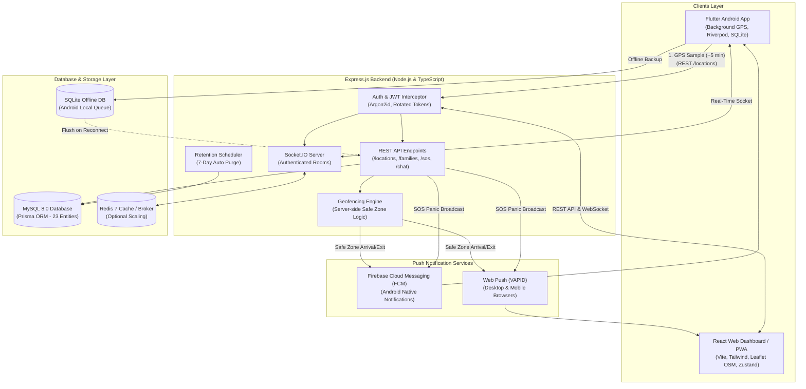
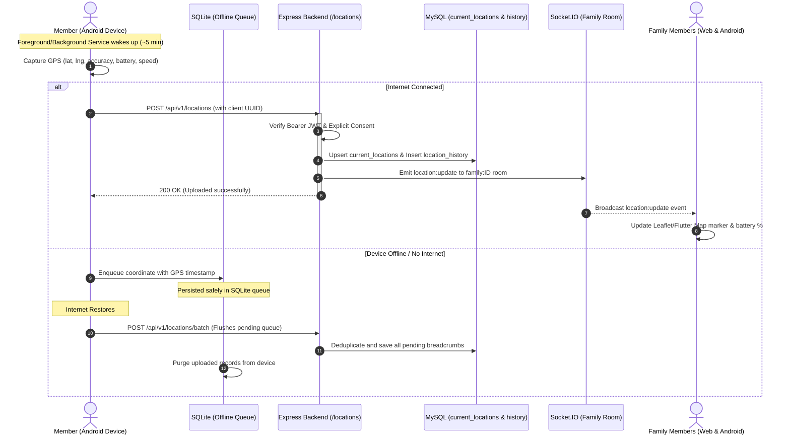
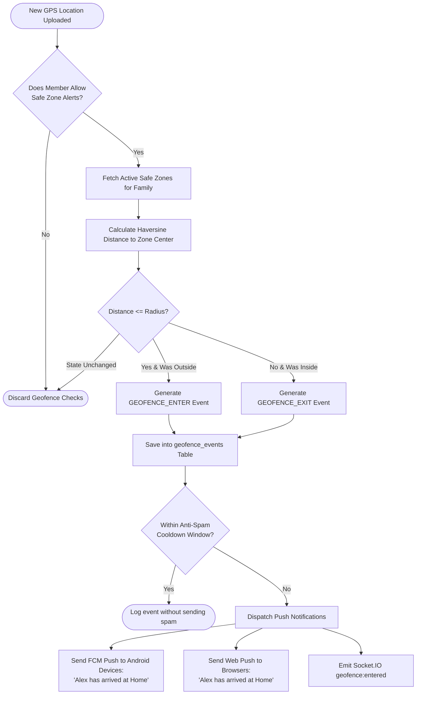
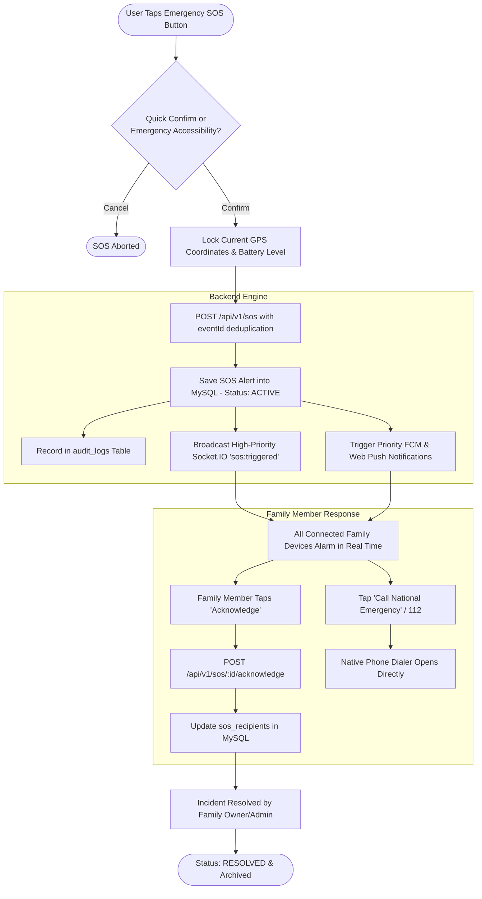

# Family Circle

> **Production-Oriented, Privacy-First, Self-Hosted Family Location Tracking & Safety System**

**Family Circle** is an end-to-end, self-hosted location tracking and emergency assistance platform designed for families. Built entirely with free, open-source technologies—with **zero reliance on paid GPS or mapping APIs**—it provides real-time location sharing, geofencing, safe-zone alerts, family chat, and emergency SOS broadcasts with strict, explicit consent and zero stealth tracking.

---

## 📑 Table of Contents

1. [Architectural Overview](#-architectural-overview)
2. [Visual Architecture & Flowcharts](#-visual-architecture--flowcharts)
3. [Monorepo Directory Structure](#-monorepo-directory-structure)
4. [Database Architecture (23 Core Entities)](#-database-architecture-23-core-entities)
5. [Backend Engine (`backend/`)](#-backend-engine-backend)
6. [React Web Dashboard & PWA (`web/`)](#-react-web-dashboard--pwa-web)
7. [Flutter Android Mobile App (`android/`)](#-flutter-android-mobile-app-android)
8. [Security, Privacy & Data Protection](#-security-privacy--data-protection)
9. [Git & Repository Security Rules](#-git--repository-security-rules)
10. [Local Development & Quickstart](#-local-development--quickstart)
11. [API Reference & Live Endpoints](#-api-reference--live-endpoints)
12. [Multi-Phase Roadmap & Status](#-multi-phase-roadmap--status)

---

## 🏗️ Architectural Overview

The system consists of three primary components coordinated through a centralized REST & WebSocket API:

```
                          ┌───────────────────────────┐
                          │   Ubuntu / Local Host     │
                          │   MySQL 8.0 & Redis 7     │
                          └─────────────┬─────────────┘
                                        │
                         ┌──────────────┴──────────────┐
                         │   Backend Engine (Port 4000)│
                         │   Express.js + TypeScript   │
                         │   Prisma ORM + Socket.IO    │
                         └──────┬───────────────┬──────┘
                                │               │
          REST / WebSocket      │               │     REST / WebSocket
          (Axios + Socket.IO)   │               │     (Dio + Socket.IO)
                                ▼               ▼
     ┌────────────────────────────┐           ┌────────────────────────────┐
     │  React Web Dashboard / PWA │           │   Flutter Android App      │
     │  (Port 5173 - Leaflet OSM) │           │   (Background GPS Tracking │
     │  Desktop, Tablet, Browser  │           │   + Offline SQLite Queue)  │
     └────────────────────────────┘           └────────────────────────────┘
```

- **Backend**: Node.js LTS, Express.js, TypeScript, Prisma ORM, MySQL 8, Socket.IO, Argon2id, Zod, Pino.
- **Web Dashboard**: React 18, Vite, TypeScript, Tailwind CSS, TanStack Query, Zustand, Leaflet OpenStreetMap.
- **Android App**: Flutter Stable, Dart, Riverpod, Dio, flutter_map, sqflite (offline queue), flutter_secure_storage.

---

## 🔄 Visual Architecture & Flowcharts

### 1. End-to-End System & Technology Flowchart

This diagram illustrates how the Android Mobile App, React Web Dashboard, Express Backend, MySQL Database, Redis, and Push Notification services interconnect:



---

### 2. Live Location Tracking & Family Map Synchronization Flow

This flowchart describes the lifecycle of a location update from device capture to family map visualization:



---

### 3. Safe Zone & Geofence Alert Notification Flow

This diagram illustrates how the system notifies family members when someone enters or exits a predefined Safe Zone (e.g., Home, School, Office):



---

### 4. Emergency SOS Alert Broadcast & Acknowledgment Flow

This flowchart illustrates the high-priority life-safety workflow triggered when a family member presses the SOS button:



---

## 📁 Monorepo Directory Structure

```text
family-circle/
├── backend/                       # REST API, Database & WebSocket server
│   ├── prisma/
│   │   ├── migrations/0_init/     # Initial SQL migration for MySQL 8.0
│   │   └── schema.prisma          # Complete Prisma schema with 23 entities
│   ├── src/
│   │   ├── config/                # Type-safe Zod env & redacted Pino logger
│   │   ├── controllers/           # Auth, User, and Family HTTP controllers
│   │   ├── docs/                  # OpenAPI 3.0 / Swagger specifications
│   │   ├── jobs/                  # Automated 7-day retention & token cleanup
│   │   ├── middleware/            # Auth, rate-limiter, request logger, error handler
│   │   ├── repositories/          # Prisma database abstraction layer
│   │   ├── routes/                # Express /api/v1 route registrations
│   │   ├── services/              # Business logic & Argon2id cryptography
│   │   ├── sockets/               # Authenticated Socket.IO connection handling
│   │   ├── types/                 # Shared TypeScript interfaces & declarations
│   │   ├── utils/                 # JWT sign/verify, response helpers, security
│   │   ├── validators/            # Zod input validation schemas
│   │   ├── app.ts                 # Express application configuration
│   │   └── server.ts              # HTTP server bootstrap & graceful shutdown
│   ├── tests/                     # Vitest unit & integration test suites
│   ├── Dockerfile                 # Multi-stage production container
│   └── package.json
│
├── web/                           # React PWA Web Dashboard
│   ├── src/
│   │   ├── components/            # Reusable UI components
│   │   ├── layouts/               # Dashboard layout (Sidebar, Header, Bottom Nav)
│   │   ├── pages/                 # LiveMap, Login, Register, Members, SOS, Settings
│   │   ├── routes/                # Protected & public routing logic
│   │   ├── services/              # Axios API client (with auto-refresh) & Socket.IO
│   │   ├── store/                 # Zustand persistent authentication store
│   │   └── types/                 # Frontend TypeScript interfaces
│   ├── index.html                 # PWA HTML shell with Leaflet styles
│   ├── vite.config.ts             # Vite dev server & proxy settings
│   └── package.json
│
├── android/                       # Flutter Android Native Application
│   ├── android/                   # Native Android host & AndroidManifest.xml
│   ├── lib/
│   │   ├── core/                  # ApiClient, SocketService, SQLite DB, Theme
│   │   ├── features/auth/         # UserModel, AuthProvider, Login/Register UI
│   │   ├── features/location/     # Background GPS Tracking Service (~5 min interval)
│   │   ├── features/map/          # LiveMapScreen (flutter_map + OSM tiles)
│   │   ├── features/family/       # FamilyScreen & invite generator
│   │   ├── features/sos/          # SosScreen (Emergency broadcast & 112 dialer)
│   │   ├── features/settings/     # Privacy consent toggles & retention selector
│   │   └── main.dart              # GoRouter, Riverpod ProviderScope, App entry
│   └── pubspec.yaml               # Flutter package dependencies
│
├── docs/
│   └── PROGRESS.md                # Multi-phase execution roadmap & status tracker
├── scripts/
│   ├── setup-env.ps1              # Windows PowerShell environment setup script
│   └── setup-env.sh               # Linux/macOS Bash environment setup script
├── docker-compose.yml             # Orchestration for MySQL 8.0, Redis 7 & Backend
├── .env.example                   # Safe template environment variables
├── .gitignore                     # Master repository security filter
└── README.md
```

---

## 🗄️ Database Architecture (23 Core Entities)

Configured in `backend/prisma/schema.prisma` with UUID primary keys, foreign key constraints, cascade rules, and optimized indexes:

| # | Entity Table | Primary Role & Description |
|---|---|---|
| 1 | **`users`** | Core user identity, Argon2id password hash, full name, phone number, avatar URL, active status. |
| 2 | **`user_settings`** | Preferences: theme (`light`/`dark`), language, retention days (default: 7), stale threshold (default: 10 min). |
| 3 | **`families`** | Family group container, name, avatar, foreign key ownership. |
| 4 | **`family_members`** | Membership join table with roles (`OWNER`, `ADMIN`, `MEMBER`), nicknames, and join timestamps. |
| 5 | **`family_invitations`** | Expiring 8-character unique alphanumeric codes (`PENDING`, `ACCEPTED`, `REJECTED`, `EXPIRED`, `CANCELLED`). |
| 6 | **`devices`** | Registered devices (`ANDROID`, `WEB`, `OTHER`), FCM push tokens, app version, last seen timestamp. |
| 7 | **`refresh_sessions`** | Secure rotated refresh token sessions, SHA-256 token hash, IP, user-agent, revocation state. |
| 8 | **`password_reset_tokens`** | Single-use cryptographic reset tokens with 1-hour expiration. |
| 9 | **`location_sharing_settings`** | **Explicit consent settings**: Adult members independently control `shareCurrentLocation`, `shareLocationHistory`, and `allowSafeZoneAlerts`. |
| 10 | **`current_locations`** | Real-time coordinate cache: latitude, longitude, accuracy, speed, heading, battery %, charging state, GPS timestamp. |
| 11 | **`location_history`** | Historical breadcrumbs indexed by `(userId, gpsTimestamp)` with client-side `eventId` deduplication. |
| 12 | **`safe_zones`** | Geofence definitions (Home, School, Office): center coordinate, radius in meters, UI color pin. |
| 13 | **`safe_zone_members`** | Member-specific geofence opt-ins with entry/exit notification toggles and current presence state. |
| 14 | **`geofence_events`** | Historical audit trail of zone transitions (`ENTER`, `EXIT`). |
| 15 | **`sos_alerts`** | Emergency incident records (`ACTIVE`, `ACKNOWLEDGED`, `RESOLVED`, `CANCELLED`), coordinates, battery percentage, deduplication ID. |
| 16 | **`sos_recipients`** | Per-member acknowledgement status and acknowledgement timestamps. |
| 17 | **`conversations`** | Family group chats and 1-on-1 private messaging channels. |
| 18 | **`conversation_members`** | Chat membership and unread message / last-read timestamp tracking. |
| 19 | **`messages`** | Text message persistence with client message IDs for offline deduplication. |
| 20 | **`message_receipts`** | Per-recipient delivery and read receipts (`DELIVERED`, `READ`). |
| 21 | **`notifications`** | In-app notification inbox history. |
| 22 | **`push_subscriptions`** | Standards-based Web Push VAPID subscriptions for browser push alerts. |
| 23 | **`call_logs`** | Click-to-call dialer initiation records (`tel:` link triggers). |
| 24 | **`audit_logs`** | Security audit log (logins, registrations, password changes, permission updates). |

---

## ⚡ Backend Engine (`backend/`)

- **Argon2id Hashing**: Industry-leading password hashing parameters (`memoryCost: 65536`, `timeCost: 3`, `parallelism: 1`).
- **Refresh Token Rotation & Reuse Detection**: Single-use refresh tokens. If a previously rotated token is re-submitted, the system treats it as a security breach and automatically revokes all active sessions for that user.
- **Log Privacy & Redaction**: The Pino logging engine automatically censors `password`, `token`, `accessToken`, `refreshToken`, `latitude`, `longitude`, and `coords` across all incoming HTTP requests.
- **Scheduled Retention Cleanup**: Background timer (`src/jobs/retentionJob.ts`) automatically purges location history older than each user's configured retention period (default 7 days) and removes expired sessions.
- **Socket.IO Real-Time Server**: Authenticated WebSockets mounted on the HTTP server with room isolation (`user:<id>`, `family:<id>`).
- **Interactive Swagger Documentation**: Full OpenAPI 3.0 specs available live at `http://localhost:4000/api/docs`.
- **Vitest Test Suite**: 13/13 unit and integration tests passing (`security.test.ts`, `validation.test.ts`, `api.test.ts`).

---

## 💻 React Web Dashboard & PWA (`web/`)

- **Interactive Live Map**: React-Leaflet integration with OpenStreetMap tiles (100% free, no billing). Displays member avatar pins, live battery percentage, charging indicator, accuracy circles, and center-on-member controls.
- **Smart Axios API Client**: Configured with automatic request interceptors for JWT token injection and a response interceptor that automatically rotates 401 expired access tokens in the background without interrupting the user.
- **Zustand Auth Store**: Lightweight, persistent session state in localStorage with auto-socket connection.
- **Responsive Layout**: Desktop left sidebar, mobile bottom navigation, family selector, notification bell, and emergency shortcut.
- **Pages**:
  - `LiveMapPage`: Interactive map view.
  - `LoginPage` & `RegisterPage`: Responsive authentication forms.
  - `FamilyMembersPage`: Member roster, roles, and 8-character invitation code generator.
  - `SosAlertsPage`: Emergency panic trigger with confirmation modal and 112 emergency phone dialer shortcut.
  - `SettingsPage`: Location sharing switches, retention days selector, and account details.

---

## 📱 Flutter Android Mobile App (`android/`)

- **Platform-Approved Background GPS Engine**: Target interval of approximately 5 minutes to balance fresh location updates with minimal battery consumption.
- **Offline SQLite Queue**: If internet connectivity is interrupted, GPS samples are securely enqueued in a local SQLite database (`OfflineLocationDb`). When network connectivity is restored, pending locations are batch-uploaded using client-side UUIDs to guarantee zero duplication.
- **Android Permissions**: Configured in `AndroidManifest.xml` for Android 10 through Android 14+:
  - `ACCESS_FINE_LOCATION`
  - `ACCESS_COARSE_LOCATION`
  - `ACCESS_BACKGROUND_LOCATION`
  - `FOREGROUND_SERVICE`
  - `FOREGROUND_SERVICE_LOCATION`
  - `POST_NOTIFICATIONS`
- **State Management & Routing**: Flutter Riverpod for reactive state management and `go_router` for declarative navigation.
- **Native Phone Dialer Integration**: Direct integration with the Android dialer (`tel:112`) for national emergency services.

---

## 🛡️ Security, Privacy & Data Protection

1. **Explicit User Consent**: Family Owners and Admins **cannot track an adult member without explicit consent**. Each member controls their independent location sharing toggles.
2. **Zero Stealth Tracking**: Android foreground services require a persistent visible notification while location tracking is active. No disguised or hidden services.
3. **No Paid GPS APIs**: Maps and tiles use OpenStreetMap; reverse geocoding and geofencing are evaluated server-side.
4. **Data Minimization & Retention**: Historical breadcrumbs are automatically deleted after the configured retention window (default: 7 days).
5. **No Coordinate Logging**: GPS coordinates are never written to plain-text server application logs.

---

## 🔒 Git & Repository Security Rules

The master [`.gitignore`](file:///e:/family-tracking-system/.gitignore) ensures no sensitive credentials or heavy build folders are committed to GitHub:

### ❌ Strictly Ignored (Never Committed)
- **Secrets & Credentials**: `**/.env`, `backend/.env`, `*.pem`, `*.key`, `serviceAccountKey.json`, `firebase-admin-key.json`, `google-services.json`.
- **Android Signing Keys**: `*.keystore`, `*.jks`, `local.properties`.
- **Dependencies**: `**/node_modules/`, `**/.dart_tool/`, `**/.pub/`, `**/.pub-cache/`.
- **Build Artifacts**: `**/dist/`, `**/build/`, `*.apk`, `*.aab`.
- **Databases & Volumes**: `mysql_data/`, `redis_data/`, `*.db`, `*.sqlite`.

### ✅ Tracked in Repository
- Clean environment template: [`.env.example`](file:///e:/family-tracking-system/.env.example).
- Complete Backend, Web Dashboard, and Flutter Android source code.
- Database schemas & migrations (`schema.prisma`, `0_init/migration.sql`).
- Docker Compose configuration and build scripts.

---

## 🚀 Local Development & Quickstart

### 1. Prerequisites
- **Node.js**: v18+ (tested on Node.js v20 / v24)
- **Docker Desktop**: For running local MySQL 8.0
- **Flutter SDK**: Stable channel (for Android app)

### 2. Environment Setup
```powershell
# Windows PowerShell
.\scripts\setup-env.ps1

# Linux / macOS
chmod +x ./scripts/setup-env.sh
./scripts/setup-env.sh
```

### 3. Start Database (MySQL 8.0)
```bash
docker compose up -d mysql
```

### 4. Run Backend Server
```bash
cd backend
npm install
npx prisma generate
npx prisma migrate deploy
npm test
npm run dev
```
- **Backend API**: `http://localhost:4000/api/v1`
- **Swagger Documentation**: `http://localhost:4000/api/docs`
- **Socket.IO Endpoint**: `ws://localhost:4000`

### 5. Run React Web Dashboard
```bash
cd web
npm install
npm run dev
```
- **Web App**: `http://localhost:5173`

### 6. Run Flutter Android App
```bash
cd android
flutter pub get
flutter run
```

---

## 📡 API Reference & Live Endpoints

### Authentication (`/api/v1/auth`)
| Method | Endpoint | Description |
|---|---|---|
| `POST` | `/auth/register` | Register new user; creates default preferences & sharing consent. |
| `POST` | `/auth/login` | Authenticate email & password; issues access & rotated refresh tokens. |
| `POST` | `/auth/refresh` | Rotate refresh token and issue a fresh access token. |
| `POST` | `/auth/logout` | Revoke active refresh session. |
| `POST` | `/auth/forgot-password` | Generate single-use password reset token. |
| `POST` | `/auth/reset-password` | Reset password using valid cryptographic token. |
| `GET` | `/auth/me` | Fetch currently authenticated user payload from access token. |

### User Profile (`/api/v1/users`)
| Method | Endpoint | Description |
|---|---|---|
| `GET` | `/users/me` | Retrieve full profile, settings, and family memberships. |
| `PATCH` | `/users/me` | Update name, phone number, and avatar URL. |
| `POST` | `/users/me/change-password` | Change password with current password verification. |
| `PATCH` | `/users/me/settings` | Update theme, language, and retention days. |
| `GET` | `/users/me/devices` | List registered user devices. |
| `DELETE` | `/users/me/devices/:id` | Unregister a device. |
| `DELETE` | `/users/me` | Permanently delete account and all personal data. |

---

## 🗺️ Multi-Phase Roadmap & Status

| Phase | Milestone | Status |
|---|---|---|
| **Phase 1** | Monorepo setup, Prisma schema (all 23 entities), MySQL migrations, Auth APIs, Swagger docs, Vitest tests | **COMPLETED** |
| **Phase 2** | Family creation, invitations, membership management, role authorization & location privacy permissions | **IN PROGRESS** |
| **Phase 3** | Flutter Android app scaffolding, Riverpod state, background GPS tracking service & SQLite offline queue | **COMPLETED** |
| **Phase 4** | Socket.IO location broadcasts & Android family live map | PENDING |
| **Phase 5** | React Web Dashboard, authentication, Leaflet family map & responsive layout | **COMPLETED** |
| **Phase 6** | FCM push notifications, PWA Web Push & SOS emergency broadcasts | PENDING |
| **Phase 7** | Family group & 1-on-1 chat, member details & native phone dialer integration | PENDING |
| **Phase 8** | Server-side geofencing, safe-zone entry/exit alerts, retention jobs & settings | PENDING |
| **Phase 9** | End-to-end integration tests, bug fixes & self-hosted Ubuntu production deployment | PENDING |

Track detailed ongoing progress in [docs/PROGRESS.md](file:///e:/family-tracking-system/docs/PROGRESS.md).
